# Vibings Overhaul

A collection of [Stash](https://stashapp.cc/) plugins that rework and extend Stash's built-in pages. Every plugin works on its own, so install only the ones you want.

## Installing

In Stash, go to **Settings → Plugins → Available Plugins → Add Source** and add:

```
https://vibingsGit.github.io/vibings-overhaul/main/index.yml
```

## Plugins

| Plugin | Type | Status |
| --- | --- | --- |
| **Vibings Battles** | UI + Python backend | 2.2.0 |
| **Vibings Stats** | UI | 2.3.1 |
| **Vibings Better Os** | UI + Python backend | 1.1.0 |
| **Vibings Play Tracking Fix** | UI + Python backend | 1.0.0 |
| **Vibings Scene Heatmap** | UI + Python backend | 1.0.0 |
| **Vibings Better Scenes** | UI | 1.0.0 |

Screenshots use placeholder images and sample names.

### Vibings Battles

Head-to-head battles that build an Elo ranking for scenes, images, performers, studios, groups and galleries.

- Pick the better of two items, call a draw or skip the pair; undo the last battle at any time
- Battle animations (epic, subtle or off) and an auto continue toggle
- **Arena**: an auto battler where performers fight a free-for-all; Elo can affect strength, and the winner gains Elo while the knocked out lose some
- Blacklist and whitelist per category, and an option to never pit the same performer against itself
- Elo scoring in the backend, mapped to Stash's `rating100` (optional sync)
- Optional performer bonus: scene and image wins also lift the performers
- Smart pairing that favours under-battled items and close matches
- Whole pictures, and items without an image show one from their own library
- Leaderboard, stats and settings; side panel layout that works on phones
- Performance options per device for weaker machines, and a database optimizer
- Settings and status checks also in Stash's **Settings → Tools → Vibings Overhaul**
- Battle log stored on the Stash server, shared across devices

<p>
  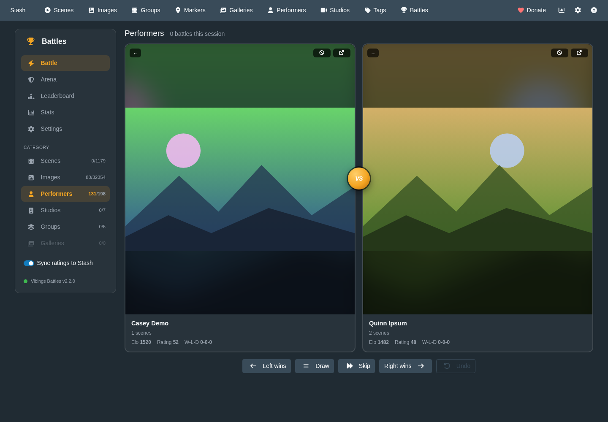
  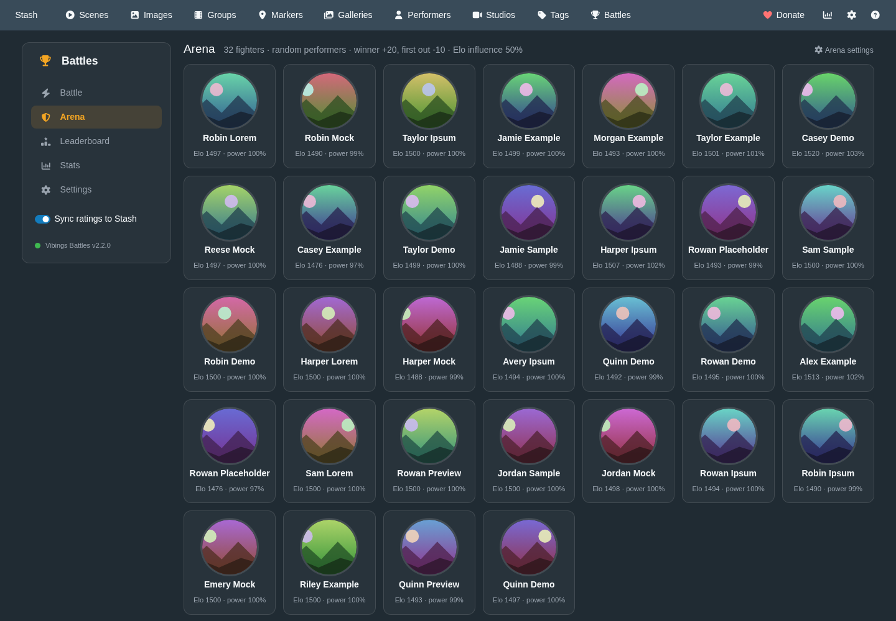
</p>
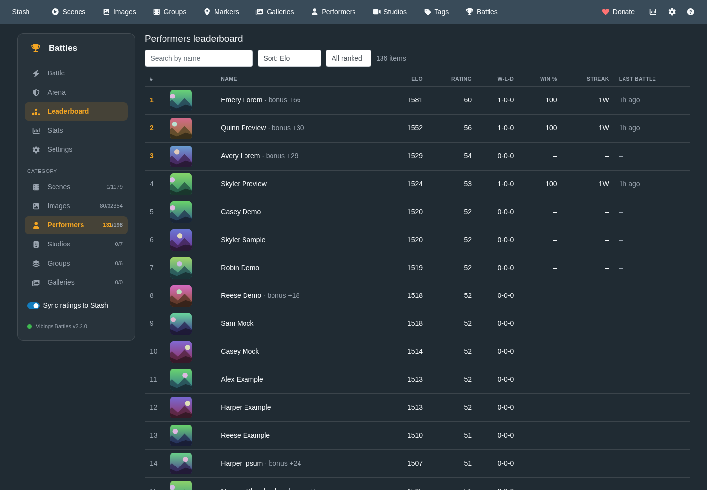

### Vibings Stats

A fast statistics page that replaces Stash's own (optional).

- Views for overview, activity (plays and O over time, weekday × hour heatmaps, streaks), library (resolutions, lengths, codecs, sizes, formats, growth), people (performers, studios, tags, groups), ratings, metadata health and plugins
- Panels appear as soon as their data is loaded; the rest loads in the background and is cached
- **Os** view: where in the video the O happens, time left in the video, image viewing time, quickest Os, tags with the most Os and recent Os (positions and viewing times come from Vibings Better Os)
- Shows statistics from other Vibings plugins, such as Vibings Battles, Vibings Better Os, Vibings Play Tracking Fix and Vibings Scene Heatmap (estimated earlier plays are shown apart from Stash's play count)
- Version and status checks for Stash and every Vibings plugin

<p>
  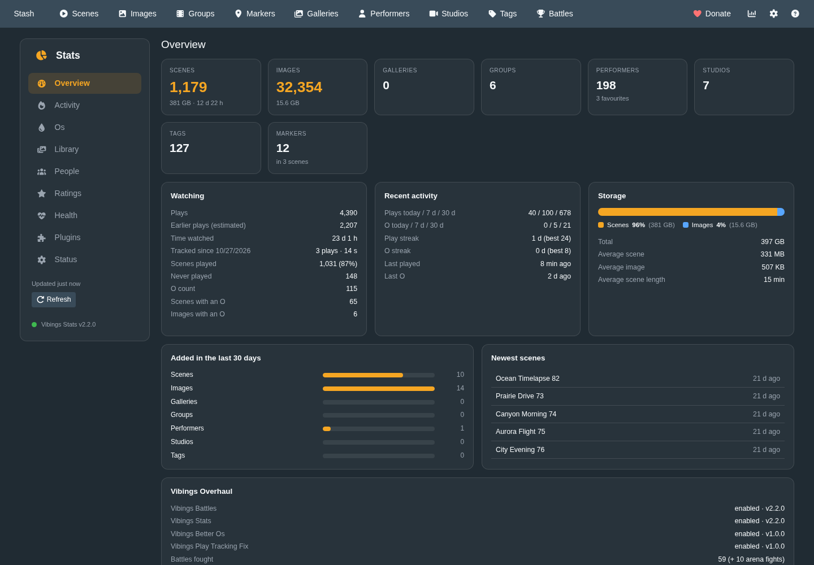
  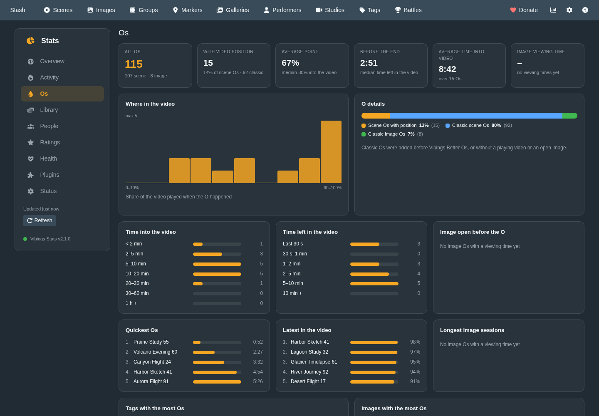
</p>

### Vibings Better Os

Gives every O a moment: the video position of scene Os and the viewing time of image Os.

- Works with Stash's own pages: Os added with any O button (scene page, History tab, image page, lightbox) are recorded
- Scene Os store the video position; image Os store how long the image had been open
- O markers on the video timeline and a pop-up animation when an O is added; an O button in the player
- **Os** tab on the scene page: every O with its position, jump to it, set or type a position, remove the position or the O
- Os without a position (for example from before the plugin) are listed as classic Os
- Data stored on the Stash server, so every device sees the same Os
- Import and export (also older O-timestamp files), automatic backups, restore and a database optimizer in **Settings → Tools → Vibings Overhaul**
- Detailed O statistics in Vibings Stats
- Works with Vibings Better Scenes' player too, and gives other plugins its Os panel and O data (`window.VibingsBetterOs`)

<p>
  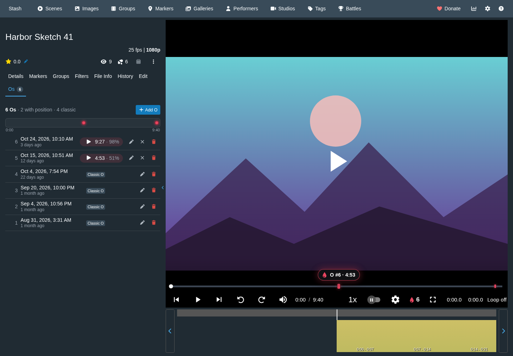
  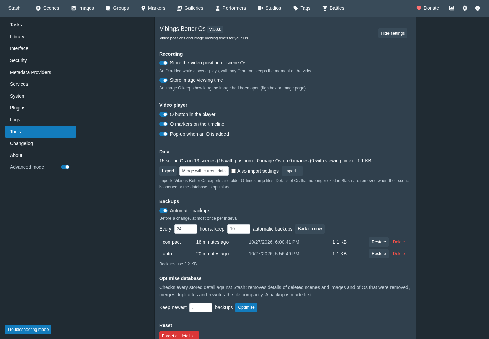
</p>
<p>
  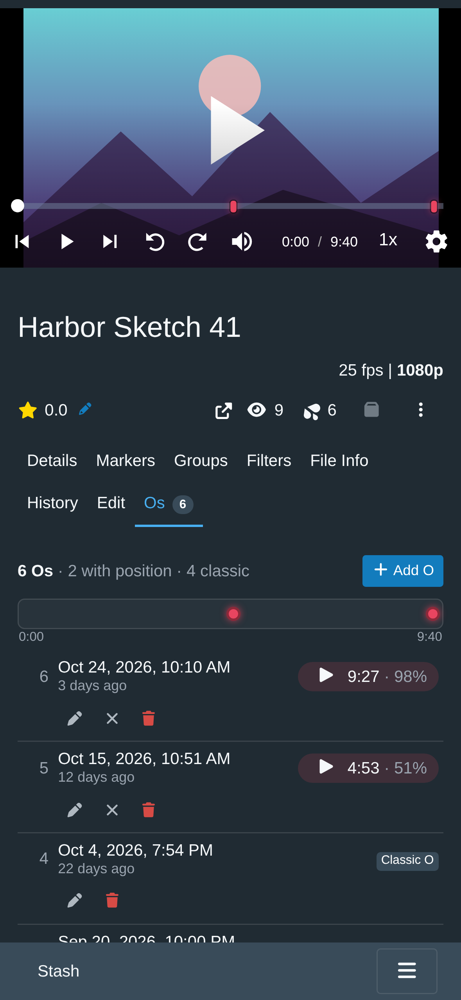
  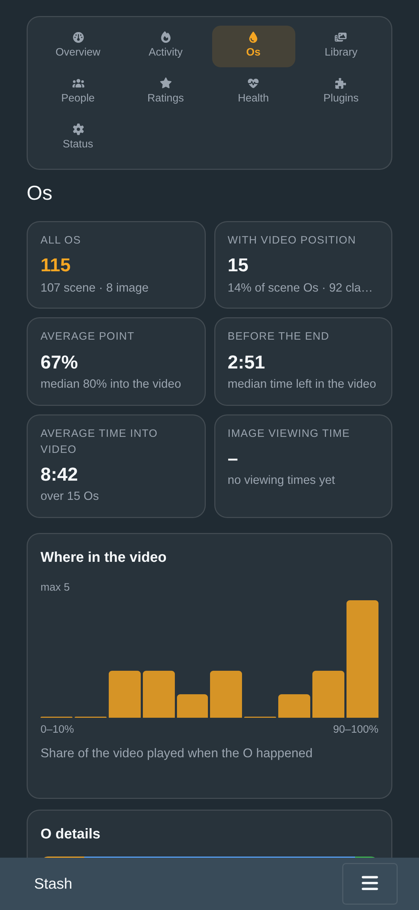
</p>

### Vibings Play Tracking Fix

Counts play time and plays from the time the video really plays.

- Works with Stash's own scene player and replaces its play tracking
- Play time grows only while the video plays: pauses, buffering and skips on the timeline do not count; faster playback counts the video time that went by
- A play counts once a set share of the video (default 25 %) has played in one viewing; a loop or a replay is a new viewing and can count again
- Resume points are saved as before; a video watched to the end starts from the beginning next time
- **Estimated earlier plays**: earlier play time divided by the scene's length estimates how many times a scene was played before the plugin
  - *Calculate* only shows the result (and a CSV)
  - *Hybrid* keeps the estimates apart from Stash's play counts (scene History tab, Vibings Stats)
  - *Replace* writes them into Stash's play history; the original plays are stored and can be put back
- Database tools: clear resume points Stash never uses, clean the plugin data, automatic backups and restore, all in **Settings → Tools → Vibings Overhaul**

<p>
  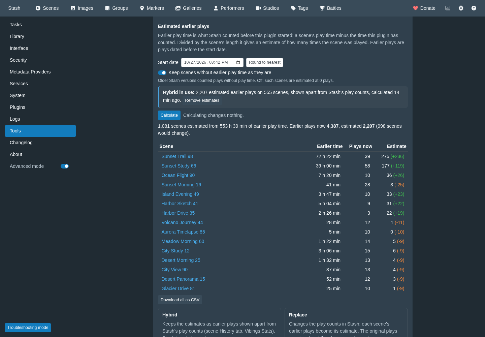
  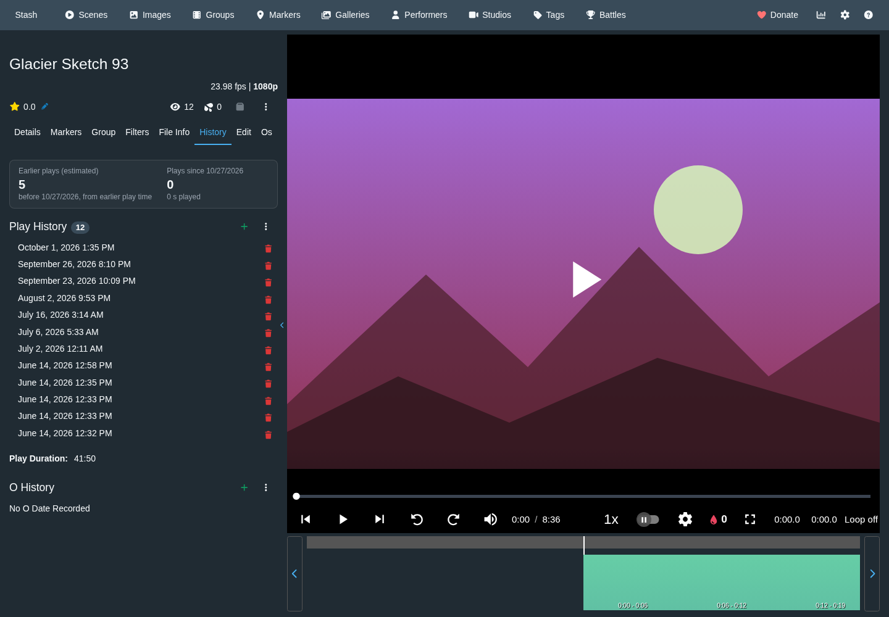
</p>
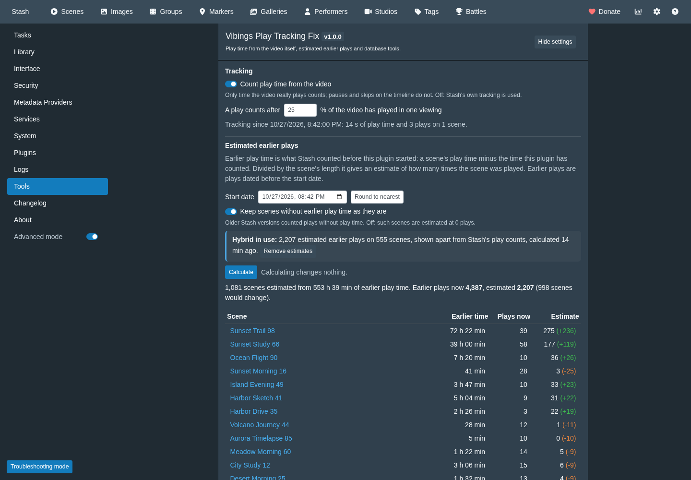

### Vibings Scene Heatmap

A curve of the most watched parts of a video over the player's timeline, like the "most replayed" curve on video sites.

- Works with Stash's own scene player and with Vibings Better Scenes
- Records the parts of each video you really watch: pauses and skips on the timeline do not count, rewatched parts rise and skipped parts stay low
- The curve grows while you watch; shown while the pointer is on the timeline, or always
- Curve height and smoothing settings, and recording can be turned off
- Data stored on the Stash server, so every device sees the same curves
- Import and export, automatic backups, restore and a database optimizer in **Settings → Tools → Vibings Overhaul**
- Shown in Vibings Stats' plugin view

### Vibings Better Scenes

A new scene page with its own player, built around the other Vibings plugins. Stash's own scene page stays one tab away.

- **Player**: thumbnail previews on the timeline, markers as chapters, O positions, A/B loop, speed, stream choice, picture in picture, theater mode and keyboard shortcuts
- Frame by frame stepping, screenshots (download, copy or set as the scene's cover) and quick markers (B) without leaving the player
- Video filters (brightness, contrast, gamma, colours, sharpen, zoom, rotate, mirror) and audio filters (boost, bass, mids, treble, balance, compressor, mono), with named presets and filters remembered per scene
- Ambient light around the player, loudness levelling, a sleep timer and Stats for nerds with live graphs
- **Mini player**: leaving the scene page while playing keeps the video going in the corner
- **Queue**: up next, drag to reorder, randomize the next scene, repeat, previews of the previous and next scene, saved queues and saving a queue as a Stash group
- Under the player: up next, continue watching, recommendations you can tune, the performers' other scenes, markers, filters and file info
- **Overview**: rating, plays, Os (latest O and a full Os panel), performers with their Elo, tags, an activity grid of plays and Os, and quick edit of the title, date, studio, performers, tags and details
- Touch: double tap to seek, swipe for the next or previous scene, swipe for the volume in fullscreen, and the screen turns to the video in fullscreen
- On wide screens the page fits the window; theater mode lets it scroll
- Uses the other Vibings plugins when they are installed: Better Os (O positions), Play Tracking Fix (play time and plays), Battles (Elo, and battles against a similar scene from the page) and Scene Heatmap (most watched curve, jump to the most watched part)
- Settings are stored on the Stash server, so every device shares them

<p>
  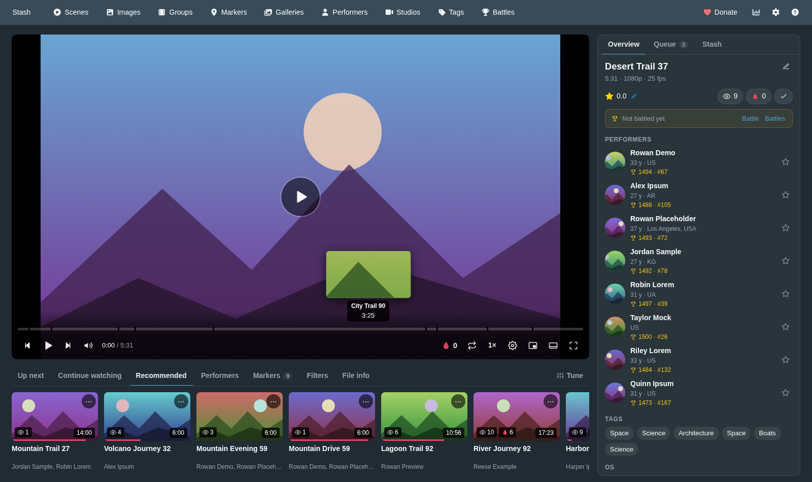
  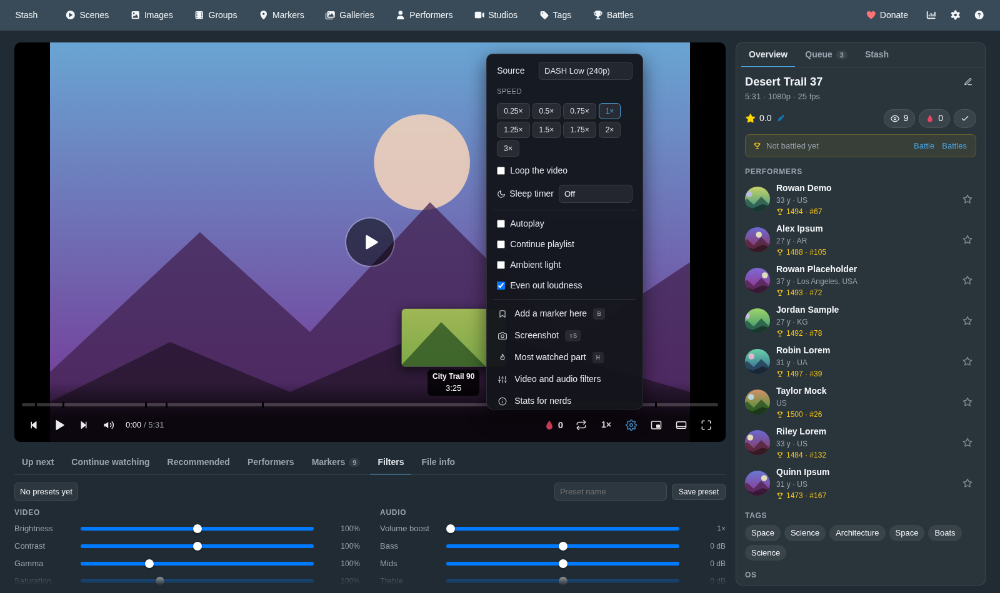
</p>
<p>
  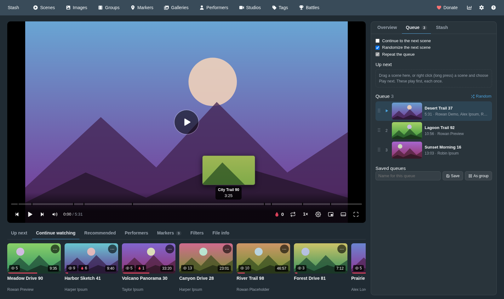
  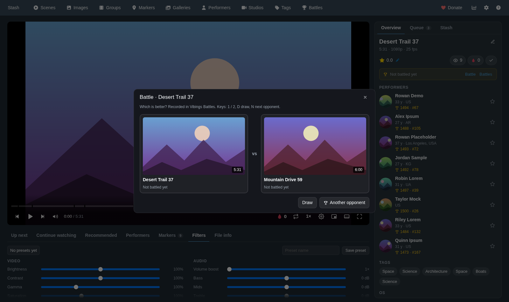
</p>
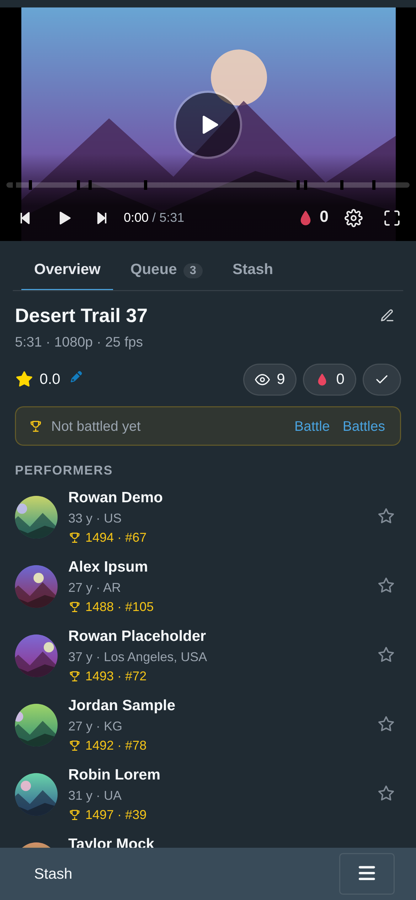

## Repository layout

| Path | Purpose |
| --- | --- |
| `src/<Plugin>/` | Plugin source (stash-plugin-builder projects) |
| `src/_shared/` | Code bundled into several plugins: the shared Settings → Tools section and the Vibings plugin list |
| `plugins/<Plugin>/` | Built plugins; pushing changes here publishes them |
| `build_site.sh` | Builds the plugin source index for GitHub Pages |
| `docs/screenshots/` | README screenshots (placeholder images, sample names) |

Each source folder has its own README with build and test commands.

## Settings

Every plugin adds its settings to one shared section in Stash: **Settings → Tools → Vibings Overhaul**, with a collapsible panel per plugin showing its version.

## License

[AGPL-3.0](LICENCE)
